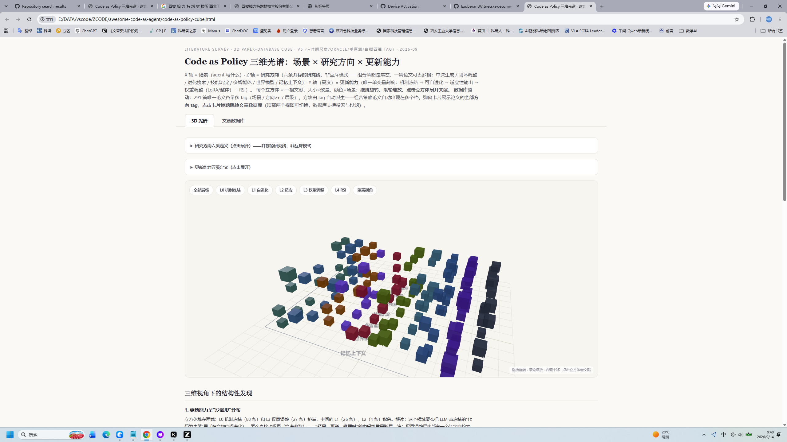

# Awesome Code as Agent

**[中文版](README_CN.md)** | **English**

> A navigable 3D knowledge map of **369 papers** on how LLM agents use executable code to perceive, act, learn, and improve — spanning **10 scenes × 7 directions × 5 update levels × 4 runtime quadrants**.

**Don't just read the list — navigate the space.**

## 🧊 Preview

| 3D Knowledge Cube | Paper Database |
|:-:|:-:|
|  |  |
| Drag · Zoom · Click cubes | Search · Filter · 8-dim tags |

## Quick Start

**Step 1** — Clone this repo:

```bash
git clone https://github.com/ExuberantWitness/awesome-code-as-agent.git
cd awesome-code-as-agent
```

**Step 2** — Open the 3D cube in your browser:

```bash
# macOS / Linux
open code-as-policy-cube.html

# Windows
start code-as-policy-cube.html

# Or just double-click the file in your file manager
```

> ⚠️ Requires internet connection (Three.js loads from CDN)

**Step 3** — Explore:

1. **Drag to rotate** the 3D lattice, scroll to zoom
2. **Click any cube** to see papers in that cell, grouped by runtime quadrants
3. **Click paper titles** in popups → jumps to the database entry with full tags
4. **Filter** by update level (L0-L4), or switch to Database view for multi-dimensional search
5. **Find research gaps** — cells showing "no papers yet" are empty research slots

## The Taxonomy

### X: Scene — What does the agent write?

| Scene | Description | Papers |
|-------|-------------|--------|
| 🎯 Policy | Code as robot/control policy | 24 |
| 🖱️ Action | Code as unified action space (GUI/OS) | 26 |
| 🏆 Reward | Code as reward function or training pipeline | 19 |
| 🔧 Skill | Code as reusable skill/library unit | 16 |
| 🛡️ Constraint | Code as safety constraint or monitor | 18 |
| 🌍 World | Code as world model / executable world | 33 |
| 📐 Design | Code as design artifact (CAD, ontology, law) | 27 |
| 🧠 Reasoning | Code as reasoning medium | 22 |
| 🤖 Agent-Self | Code as the agent's own architecture | 25 |
| 🔬 Research | Code as the research process itself | 26 |

### Z: Research Direction — How does the agent write?

| Direction | Philosophy |
|-----------|-----------|
| One-shot | Generate once, no iteration |
| Closed-Loop | Generate → execute → diagnose → revise |
| Evolutionary | Population + parallel evaluation + selection |
| Skill Accumulation | "Turn one-time success into retrievable assets" |
| Multi-Agent | Role division across multiple agents |
| World Model | Feedback via a world model, not direct interaction |
| Memory/Context | Management of experience representations is itself improved |

### Y: Update Capability — Where does improvement land?

| Level | Name | Description |
|-------|------|-------------|
| L0 | Mechanism Frozen | LLM frozen, no self-improvement |
| L1 | Self-Evolvable | Modify prompts/workflows/skills, no weights |
| L2 | Adaptive Output | Test-time training, no permanent weights |
| L3 | Weight Adjustment | Formal weight updates (LoRA or full SFT/RL) |
| L4 | RSI | Self-update with accelerating improvement |

### Time Quadrant — Runtime behavior (2-bit)

| | Train ✓ | Train ✗ |
|---|---|---|
| **Collect ✓** | 🔴 A: Online learning (52) | 🟡 B: Experience accumulation (128) |
| **Collect ✗** | 🔵 C: Input-stream adaptation (6) | ⚪ D: Frozen (95) |

## Additional Tags

- **Feedback Stack**: ★ Evidence → ★★ Verification → ★★★ Data Flywheel
- **Oracle Type**: ⚙ Symbolic / 🖥 Simulation / 🧠 Model / 🦾 Real / 👤 Human
- **Domain**: 14 verticals (robot, software, math, chip, CAD, frontend, ontology, law, ...)
- **Self-Referential Closure**: 🪞 Does the improvement target include the improver itself?

## Key Findings

1. **Hourglass distribution** — L0 (frozen) and L3 (weight training) are crowded; L1/L2 (lightweight, reversible) are the gap
2. **World models have 5 roles** — oracle / training ground / filter / imagination space / intrinsic motivation source
3. **Code space vs latent space** — two parallel world model methodologies (CWM writes executable Python; PAN predicts in JEPA latent)
4. **RSI vertical ladder** — Math (STP→AZR), Software (SICA→Frontis-MA1→DGM), Drug discovery (molecular self-improvement)
5. **Memory direction is exploding** — from MemGPT to Memory-R1 (RL-trained memory operations), plus self-programming memory (MemCodex) and learnable CRUD policies (AtomMem)
6. **Harness-RSI cluster has formed** (L4 × agent-self) — DGM stood alone; now SoL-Pi (NVIDIA, auto-research loops recursively optimizing the agent harness, 3.4k stars), RRSI (first systematic diagnosis of harness-RSI overfitting), and RSI-Anything join it
7. **World model × L4 was a blank cell — now filled** — RSI-Anything uses JEPA predictive world models to guide both action selection and learning-data selection, connecting the two formerly separate clusters
8. **Auto-defined rubrics** — the verifier library has a second auto-fill path: instead of memorizing verification experience, systems now synthesize structured criteria (RaR, Rubric-ARM's co-evolving generator+judge, RM-R1), converging on executable rubrics — the natural-language twin of the reward-code line (Text2Reward/Eureka)

## Recent Updates

- **2026-10-16 — +26 papers (369 total)**
  - **Weight×harness bridge** — [Evo²](https://arxiv.org/abs/2610.13025) co-evolves model weights and the agent harness with a dual-role Proposer/Reflector, training the evolver itself (L4); the evolved harness transfers cross-benchmark without further evolution
  - 🎯 **Filled the last blank frontier cell: World model × L4** — [RSI-Anything](https://arxiv.org/abs/2610.13912) (JEPA-Anything) lets a predictive world model select both actions and learning data, with compatibility checks gating retention
  - **Harness-RSI cluster formed** — [SoL-Pi](https://arxiv.org/abs/2609.20519) (NVIDIA, 3.4k★: auto-research loops that recursively optimize the agent's own harness) + [RRSI](https://arxiv.org/abs/2609.24972) (regularization against harness overfitting — the ML-101 lesson DGM was missing)
  - **Memory self-evolution thickens** — MemCodex (open-ended evolution of memory programs), AtomMem (RL-trained CRUD policies), RSI Agent (training-free 3-agent exploration)
  - **Autoresearch pathology** — Fork-and-Flush's "idea basins" (repeated runs get trapped in local solution regions) and Arbor's hypothesis-tree countermeasure
- **2026-10-15 — +12 papers (343 total)**
  - **Auto-rubric line imported** (RaR, Rubric-ARM, RM-R1, Self-Taught Evaluators, AutoBencher, …) — the verifier library's second auto-fill path
  - **PRSI manifesto** — physical recursive self-improvement (P1–P5 causal positions), the physical-world mirror of the DFM endpoint

## Paper Index (369)

<!-- PAPER-INDEX:START -->
<!-- Paper index (generated by tools/gen_paper_table.js — do not edit by hand) -->
**369 papers** in a single table, clustered by scene and sorted by update capability within each. Each of the 8 dimensions gets its own column — see [The Taxonomy](#the-taxonomy) and [Additional Tags](#additional-tags). The last column, "Improves itself?", marks whether the improvement loop reaches back to the mechanism that produces the improvements (e.g., DGM rewrites its own code).

| # | Paper | Scene | Direction | Update Capability | Runtime Behavior | Feedback Stack | Oracle | Domain | Improves itself? |
|---|---|---|---|---|---|---|---|---|---|
| 1 | [Puro-2B: Poor Lab Qwen2-1.5B Trained on RTX 5090 within $5090](https://arxiv.org/abs/2608.27370) | Policy | One-shot | Weight training | Collects data + trains | Evidence feedback | Symbolic | NLP | No |
| 2 | [CLIFT: Turning Gemini Robotics On-Device into Humanoid Specialists via Non-Invasive Closed-Loop Iterative Fine-Tuning](https://arxiv.org/abs/2607.29172) | Policy | Closed-loop | Weight training | Collects data + trains | Verification feedback | Real-world | Robotics | No |
| 3 | [Sirius: Human-in-the-Loop Autonomy and Learning During Deployment](https://arxiv.org/abs/2211.08416) | Policy | Closed-loop | Weight training | Collects data + trains | Data flywheel | Real-world, Human | Robotics | No |
| 4 | [Learning While Deploying (LWD): Fleet-Scale Offline-to-Online RL for Generalist Robots](https://arxiv.org/abs/2605.00416) | Policy | Closed-loop, Multi-agent | Weight training | Collects data + trains | Data flywheel | Real-world | Robotics | No |
| 5 | [OHP-RL: Online Human Preference Reinforcement Learning for Real-World Manipulation](https://arxiv.org/abs/2605.15971) | Policy, Reward | Closed-loop | Weight training | Collects data + trains | Data flywheel | Real-world, Human | Robotics | No |
| 6 | [LifeLong-RFT: Continual Learning VLA Models via Reinforcement Fine-Tuning](https://arxiv.org/abs/2602.10503) | Policy | Closed-loop, Memory | Weight training | Collects data + trains | Data flywheel | Real-world | Robotics | No |
| 7 | [Self-Adapting Robotic Agents through Online Continual Reinforcement Learning](https://arxiv.org/abs/2603.04029) | Policy | Closed-loop, Memory | Weight training | Collects data + trains | Data flywheel | Real-world | Robotics | No |
| 8 | [What Matters for Simulation-to-Online Reinforcement Learning](https://arxiv.org/abs/2602.20220) | Policy | One-shot | Weight training | Collects data + trains | Verification feedback | Real-world | Robotics | No |
| 9 | [RL-100: Performant Robotic Manipulation with Real-World RL](https://arxiv.org/abs/2510.14830) | Policy | Closed-loop | Weight training | Collects data + trains | Data flywheel | Real-world | Robotics | No |
| 10 | [Long-Horizon Planning in World Models with Latent Planners](https://arxiv.org/abs/2606.09311) | Policy | World-model | Weight training | Collects data + trains | Verification feedback | Simulation | General | No |
| 11 | [Sparse Imagination: Efficient Visual World Model Planning](https://arxiv.org/abs/2506.01392) | Policy | World-model | Weight training | Collects data + trains | Verification feedback | Simulation | Robotics | No |
| 12 | [Dream to Manipulate: Compositional World Models Empowering Robot Imitation Learning](https://dreamtomanipulate.github.io/) | Policy, World | World-model | Weight training | Collects data + trains | Data flywheel | Simulation, Real-world | Robotics | No |
| 13 | [AOR: Act-Observe-Rewrite for Robot Manipulation Policy Improvement](https://arxiv.org/abs/2603.04466) | Policy | Closed-loop | Weight training | Collects data + trains | Data flywheel | Real-world, Simulation | Robotics | No |
| 14 | [Dreamer 4: Training Agents Inside of Scalable World Models](https://arxiv.org/abs/2509.24527) | Policy | World-model | Weight training | Collects data + trains | Verification feedback | Model | General | No |
| 15 | [MuZero: Mastering Atari, Go, Chess and Shogi by Planning with a Learned Model](https://arxiv.org/abs/1911.08265) | Policy | World-model | Weight training | Collects data + trains | Verification feedback | Simulation | General | No |
| 16 | [DreamerV3: Mastering Diverse Domains through World Models](https://arxiv.org/abs/2301.04104) | Policy | World-model | Weight training | Collects data + trains | Verification feedback | Simulation | General | No |
| 17 | [Robot-Powered Data Flywheel (RPDF)](https://arxiv.org/abs/2511.19647) | Policy | Closed-loop | Weight training | Collects data + trains | Data flywheel | Real-world, Model | Robotics | No |
| 18 | [DexFlyWheel](https://arxiv.org/abs/2509.23829) | Policy | Closed-loop | Weight training | Collects data + trains | Data flywheel | Real-world, Model | Robotics | No |
| 19 | [VERITAS](https://arxiv.org/abs/2606.18247) | Policy | Closed-loop | Weight training | Collects data, no training | Data flywheel | Model, Real-world | General | No |
| 20 | [CodeDiffuser](https://www.roboticsproceedings.org/rss21/p072.pdf) | Policy | One-shot | Weight training | Frozen at runtime | Evidence feedback | — | General | No |
| 21 | [RoboPro (Robotic Programmer)](https://arxiv.org/abs/2501.04268) | Policy | One-shot | Weight training | Frozen at runtime | Verification feedback | Model, Human | General | No |
| 22 | [TT-VLA: On-the-Fly VLA Adaptation via Test-Time Reinforcement Learning](https://arxiv.org/abs/2601.06748) | Policy | Closed-loop, World-model | Adapts at runtime | Collects data + trains | Data flywheel | Real-world | Robotics | No |
| 23 | [Dejavu: Post-Deployment Learning for Embodied Agents via Experience Feedback Network](https://arxiv.org/abs/2510.10181) | Policy | Closed-loop, Memory | Adapts at runtime | Collects data + trains | Data flywheel | Real-world | Robotics | No |
| 24 | [AdaWorldPolicy: World-Model-Driven Diffusion Policy with Test-Time Adaptation](https://arxiv.org/abs/2602.20057) | Policy | World-model | Adapts at runtime | Trains, no data collection | Verification feedback | Model | Robotics | No |
| 25 | [Episodic Memory for Long-Horizon Robotic Manipulation](https://openreview.net/pdf?id=BBgDA4y0B9) | Policy | Memory | Mechanism self-evolves | Collects data, no training | Data flywheel | Real-world | Robotics | No |
| 26 | [MemoAct: Memory-Augmented Robotic Policies](https://tlf-tlf.github.io/MemoActPage/) | Policy | Memory | Mechanism self-evolves | Collects data, no training | Data flywheel | Real-world, Model | Robotics | No |
| 27 | [RoboPara](https://proceedings.iclr.cc/paper_files/paper/2026/file/e8aa3f5e8b5f24b830f31fd828e2a2a3-Paper-Conference.pdf) | Policy | Skill-accrual | Mechanism self-evolves | Collects data, no training | Data flywheel | Model | General | No |
| 28 | [ASPIRE: Agentic Skills Discovery for Robotics](https://arxiv.org/abs/2607.00272) | Policy | Skill-accrual, Closed-loop | Mechanism self-evolves | Collects data, no training | Data flywheel | Real-world, Simulation | Robotics | No |
| 29 | [EpiMem: Episodic Memory Indexing for Pretrained Manipulation Policies](https://arxiv.org/abs/2603.24576) | Policy | Memory | Frozen mechanism | Collects data, no training | Data flywheel | Real-world | Robotics | No |
| 30 | [RISE (Embodied): Compositional World Model Imagined Rollouts for Robot Policy](https://arxiv.org/abs/2602.11075) | Policy | World-model | Frozen mechanism | Collects data + trains | Verification feedback | Simulation | Robotics | No |
| 31 | [Large Language Models as Commonsense Knowledge for Large-Scale Task Planning (LLM-MCTS)](https://arxiv.org/abs/2305.14078) | Policy | World-model | Frozen mechanism | Frozen at runtime | Verification feedback | Model | General | No |
| 32 | [GenSwarm](https://www.nature.com/articles/s44182-025-00065-w) | Policy | Multi-agent | Frozen mechanism | Frozen at runtime | Evidence feedback | Real-world | Robotics | No |
| 33 | [Genesys](https://dl.acm.org/doi/10.1145/3776736) | Policy | Evolutionary | Frozen mechanism | Collects data, no training | — | Simulation | General | No |
| 34 | [Code Evolution for Control](https://arxiv.org/abs/2601.06845) | Policy | Evolutionary | Frozen mechanism | Collects data, no training | Verification feedback | Simulation | General | No |
| 35 | [Evolution through Large Models (ELM)](https://arxiv.org/abs/2206.08896) | Policy | Evolutionary | Frozen mechanism | Collects data, no training | Verification feedback | Simulation | Robotics | No |
| 36 | [OmniManip](https://arxiv.org/abs/2501.03841) | Policy | Closed-loop | Frozen mechanism | Collects data, no training | Verification feedback | Model, Simulation | General | No |
| 37 | [Contact-Rich Adaptive LLM-based Control (CoRAL)](https://arxiv.org/abs/2605.02600) | Policy | Closed-loop | Frozen mechanism | Collects data, no training | Verification feedback | Real-world, Simulation | Robotics | No |
| 38 | [RoboInspector](https://arxiv.org/abs/2508.21378) | Policy | Closed-loop | Frozen mechanism | Collects data, no training | Verification feedback | Simulation | General | No |
| 39 | [RoboCodeX](https://arxiv.org/abs/2402.16117) | Policy | One-shot | Frozen mechanism | Frozen at runtime | — | — | General | No |
| 40 | [ChatGPT for Robotics](https://arxiv.org/abs/2306.17582) | Policy | One-shot | Frozen mechanism | Frozen at runtime | — | — | Robotics | No |
| 41 | [Robot Policy Code for High-Precision Tasks](https://scholar.google.com/scholar?q=%22Generating+Robot+Policy+Code%22+dexterous) | Policy | One-shot | Frozen mechanism | Frozen at runtime | — | — | General | No |
| 42 | [VoxPoser](https://arxiv.org/abs/2307.05973) | Policy | One-shot | Frozen mechanism | Frozen at runtime | Evidence feedback | — | General | No |
| 43 | [ProgPrompt](https://arxiv.org/abs/2209.11302) | Policy | One-shot | Frozen mechanism | Frozen at runtime | Evidence feedback | — | General | No |
| 44 | [Code as Policies](https://arxiv.org/abs/2209.07753) | Policy | One-shot | Frozen mechanism | Frozen at runtime | Evidence feedback | — | Robotics | No |
| 45 | [CoRe: Collaborative Reinforcement Learning for Multi-Agent Code Generation](https://arxiv.org/abs/2605.24812) | Action | Multi-agent, Closed-loop | Weight training | Collects data + trains | Data flywheel | Symbolic | Software | No |
| 46 | [RLUF: Reinforcement Learning from User Feedback](https://arxiv.org/abs/2505.14946) | Action, Reward | Closed-loop | Weight training | Collects data + trains | Data flywheel | Human | General | No |
| 47 | [WebRL: Training LLM Web Agents via Self-Evolving Online Curriculum Reinforcement Learning](https://arxiv.org/abs/2411.02337) | Action | Closed-loop, Evolutionary | Weight training | Collects data + trains | Data flywheel | Symbolic | Web | No |
| 48 | [Tool-R0: Self-Evolving LLM Agents for Tool-Learning from Zero Data](https://arxiv.org/abs/2602.21320) | Action | Evolutionary, Closed-loop | Weight training | Collects data + trains | Data flywheel | Symbolic | General | No |
| 49 | [UI-TARS: Pioneering Automated GUI Interaction with Native Agents](https://arxiv.org/abs/2501.12326) | Action | One-shot | Weight training | Frozen at runtime | Verification feedback | — | GUI | No |
| 50 | [SWEET-RL: Training Multi-Turn LLM Agents on Collaborative Tasks](https://arxiv.org/abs/2503.15478) | Action | Multi-agent | Weight training | Collects data + trains | Verification feedback | Model | Software | No |
| 51 | [Socratic-SWE: Self-Evolving Coding Agents via Trace-Driven Evolution](https://arxiv.org/abs/2606.07412) | Action | Closed-loop | Weight training | Collects data, no training | Data flywheel | Symbolic | Software | No |
| 52 | [Reinforcement World Model Learning (RWML)](https://arxiv.org/abs/2602.05842) | Action | World-model | Weight training | Collects data + trains | — | Model | General | No |
| 53 | [Web Agents with World Models (WMA)](https://openreview.net/forum?id=moWiYJuSGF) | Action | World-model | Weight training | Collects data + trains | — | Simulation | Frontend | No |
| 54 | [ToolGen: Unified Tool Retrieval and Calling via Generation（近邻）](https://openreview.net/forum?id=XLMAMmowdY) | Action | One-shot | Weight training | Frozen at runtime | — | — | General | No |
| 55 | [AgentTuning: Enabling Generalized Agent Abilities for LLMs](https://arxiv.org/abs/2310.12823) | Action | Closed-loop | Weight training | Frozen at runtime | Verification feedback | Symbolic | General | No |
| 56 | [OpenHands CodeAct 2.1](https://www.openhands.dev/blog/openhands-codeact-21-an-open-state-of-the-art-software-development-agent) | Action | Closed-loop | Weight training | Frozen at runtime | — | Model | General | No |
| 57 | [CodeActInstruct → CodeActAgent](https://huggingface.co/xingyaoww/CodeActAgent-Mistral-7b-v0.1) | Action | Closed-loop | Weight training | Frozen at runtime | Data flywheel | Symbolic | Software | No |
| 58 | [TT-SI: Self-Improving LLM Agents with Test-Time Training](https://aclanthology.org/2026.findings-acl.462.pdf) | Action | Closed-loop | Adapts at runtime | Collects data + trains | Verification feedback | Model | General | No |
| 59 | [Grounded Test-Time Adaptation for LLM Agents](https://arxiv.org/abs/2511.04847) | Action | Closed-loop | Adapts at runtime | Collects data + trains | Verification feedback | Symbolic | General | No |
| 60 | [aTTT: Agentic Test-Time Training for LLM Agents](https://arxiv.org/abs/2607.03441) | Action | Closed-loop | Adapts at runtime | Collects data + trains | Verification feedback | Symbolic | General | No |
| 61 | [Scaling Agent Productivity with Automated Tool Generation](https://arxiv.org/abs/2512.24615) | Action | Skill-accrual | Mechanism self-evolves | Collects data, no training | Data flywheel | Symbolic | Math | No |
| 62 | [H-EPM: Experience-Evolving Multi-Turn Tool-Use Agent with Hybrid Episodic-Procedural Memory](https://arxiv.org/abs/2512.07287) | Action | Memory | Mechanism self-evolves | Collects data, no training | Data flywheel | Symbolic | General | No |
| 63 | [WebXSkill: Skill Learning for Autonomous Web Agents](https://arxiv.org/abs/2604.13318) | Action | Skill-accrual | Mechanism self-evolves | Collects data, no training | Data flywheel | Symbolic | Web | No |
| 64 | [Runtime Harness Adaptation for Deterministic LLM Agents](https://arxiv.org/abs/2605.22166) | Action | Closed-loop | Mechanism self-evolves | Collects data, no training | Verification feedback | Symbolic | Software | No |
| 65 | [PILOT in the Loop: Live Self-Improvement for Long-Horizon Agents](https://arxiv.org/abs/2608.26530) | Action | Closed-loop, Skill-accrual | Mechanism self-evolves | Collects data, no training | Data flywheel | Symbolic, Real-world | General | No |
| 66 | [ExpeL: LLM Agents Are Experiential Learners](https://arxiv.org/abs/2308.10144) | Action | Skill-accrual, Memory | Mechanism self-evolves | Collects data, no training | Data flywheel | Model | General | No |
| 67 | [SICA: A Self-Improving Coding Agent](https://arxiv.org/abs/2504.15228) | Action | Closed-loop | Mechanism self-evolves | Collects data, no training | Verification feedback | Symbolic | Software | Yes |
| 68 | [Live-SWE-agent: Can Software Engineering Agents Self-Evolve on the Fly?](https://arxiv.org/abs/2511.13646) | Action | Closed-loop | Mechanism self-evolves | Collects data, no training | Verification feedback | Symbolic | Software | No |
| 69 | [LATM (LLMs as Tool Makers)](https://openreview.net/forum?id=qV83K9d5WB) | Action | Skill-accrual | Mechanism self-evolves | Collects data, no training | Verification feedback | Model | General | No |
| 70 | [CRAFT: Customizing LLMs by Creating and Retrieving Specialized Tools](https://arxiv.org/abs/2309.17428) | Action | Skill-accrual | Mechanism self-evolves | Frozen at runtime | Data flywheel | Model | General | No |
| 71 | [DynaSaur](https://arxiv.org/abs/2411.01747) | Action | Skill-accrual | Mechanism self-evolves | Collects data, no training | Data flywheel | Model | General | No |
| 72 | [SkillWeaver: Web Agents can Self-Improve by Discovering and Honing Skills](https://arxiv.org/abs/2504.07079) | Action | Skill-accrual | Mechanism self-evolves | Collects data, no training | Data flywheel | Model | General | No |
| 73 | [Agent Workflow Memory (AWM)](https://arxiv.org/abs/2409.07429) | Action | Skill-accrual, Memory | Mechanism self-evolves | Collects data, no training | Data flywheel | Model | Frontend | No |
| 74 | [SWE-bench Science: Can Coding Agents Resolve Engineering Tasks in Science?](https://arxiv.org/abs/2608.19799) | Action, Research | One-shot | Frozen mechanism | Frozen at runtime | Verification feedback | Symbolic | Software | No |
| 75 | [World-Model-Augmented Web Agents with Action Correction](https://arxiv.org/abs/2602.15384) | Action | World-model | Frozen mechanism | Collects data, no training | Verification feedback | Model | Web | No |
| 76 | [CREATOR: Tool Creation for Disentangling Abstraction and Reasoning](https://arxiv.org/abs/2305.14318) | Action | Skill-accrual | Frozen mechanism | Frozen at runtime | Verification feedback | Symbolic | General | No |
| 77 | [Is Your LLM Secretly a World Model of the Internet? (WebDreamer)](https://arxiv.org/abs/2411.06559) | Action | World-model | Frozen mechanism | Collects data, no training | Verification feedback | Model | Web | No |
| 78 | [LATS（近邻）](https://arxiv.org/abs/2310.04406) | Action | Evolutionary | Frozen mechanism | Collects data, no training | Verification feedback | Simulation | General | No |
| 79 | [CoAct-1: Computer-Using Agents with Coding as Actions](https://arxiv.org/abs/2508.03923) | Action | Closed-loop, Multi-agent | Frozen mechanism | Collects data, no training | Verification feedback | Symbolic | GUI | No |
| 80 | [CodeAct: Executable Code Actions Elicit Better LLM Agents](https://arxiv.org/abs/2402.01030) | Action | Closed-loop | Frozen mechanism | Collects data, no training | Verification feedback | Symbolic | Software | No |
| 81 | [Agent S3 / OSWorld-ACI](https://github.com/simular-ai/agent-s) | Action | One-shot | Frozen mechanism | Frozen at runtime | — | Symbolic | Frontend | No |
| 82 | [Self-Taught Evaluators](https://arxiv.org/abs/2408.02666) | Reward | Closed-loop | Weight training | Collects data + trains | Verification feedback | Model | NLP | Yes |
| 83 | [RM-R1: Reward Modeling as Reasoning](https://arxiv.org/abs/2505.02387) | Reward | Closed-loop | Weight training | Collects data + trains | Verification feedback | Model | NLP | No |
| 84 | [Rubric-ARM: Alternating RL for Rubric-Based Reward Modeling](https://arxiv.org/abs/2602.01511) | Reward | Closed-loop, Multi-agent | Weight training | Collects data + trains | Verification feedback | Model | NLP | Yes |
| 85 | [Weaver: Shrinking the Generation-Verification Gap with Weak Verifiers](https://arxiv.org/abs/2506.18203) | Reward | One-shot | Weight training | Collects data + trains | Data flywheel | Model | General | No |
| 86 | [From Curiosity to Competence: How World Models Interact with the Dynamics of Exploration](https://arxiv.org/abs/2507.08210) | Reward, Policy | World-model | Weight training | Collects data + trains | Verification feedback | Simulation | General | No |
| 87 | [Large Reward Models: Generalizable Online Robot Reward Models](https://arxiv.org/abs/2603.16065) | Reward | Closed-loop | Weight training | Collects data + trains | Data flywheel | Real-world, Human | Robotics | No |
| 88 | [DERL: Differentiable Evolutionary Discovery of Optimal Reward Structures](https://arxiv.org/abs/2512.13399) | Reward | Evolutionary | Weight training | Collects data + trains | Data flywheel | Simulation | General | No |
| 89 | [Self-Rewarding Language Models](https://arxiv.org/abs/2401.10020) | Reward | Closed-loop | Weight training | Collects data + trains | Data flywheel | Model | General | No |
| 90 | [SER: Self-Evolved Reward Learning for LLMs](https://arxiv.org/abs/2411.00418) | Reward | Closed-loop | Weight training | Collects data + trains | Data flywheel | Model | General | No |
| 91 | [RM-Distiller（近邻）](https://arxiv.org/abs/2601.14032) | Reward | One-shot | Weight training | Frozen at runtime | — | — | General | No |
| 92 | [Generating and Refining Dynamic Evaluation Rubrics for LLM-as-a-Judge](https://arxiv.org/abs/2605.30568) | Reward | Closed-loop | Adapts at runtime | Collects data, no training | Verification feedback | Model | NLP | No |
| 93 | [Inference-Time Reward Hacking in Large Language Models](https://arxiv.org/abs/2508.08884) | Reward | One-shot | Adapts at runtime | Frozen at runtime | Verification feedback | Model | General | No |
| 94 | [TDRM: Smooth Reward Models with Temporal Difference for LLM Reasoning](https://openreview.net/forum?id=j2oWVgTFNX) | Reward | World-model, Closed-loop | Mechanism self-evolves | Frozen at runtime | Verification feedback | Model | Math | No |
| 95 | [ENPIRE: Agentic Robot Policy Self-Improvement in the Real World](https://arxiv.org/abs/2606.19980) | Reward | Multi-agent, Closed-loop | Mechanism self-evolves | Collects data, no training | Data flywheel | Real-world | Robotics | No |
| 96 | [OpenRubrics: Scalable Synthetic Rubric Generation for Reward Modeling](https://arxiv.org/abs/2510.07743) | Reward | Evolutionary | Frozen mechanism | Frozen at runtime | Verification feedback | Model, Human | NLP | No |
| 97 | [Autorubric: A Unifying Framework for Rubric-Based LLM Evaluation on Non-Verifiable Tasks](https://arxiv.org/abs/2603.00077) | Reward | One-shot | Frozen mechanism | Frozen at runtime | Verification feedback | Model | NLP | No |
| 98 | [AutoRubric: Rubric-Based Generative Rewards for Faithful Multimodal Reasoning](https://arxiv.org/abs/2510.14738) | Reward | One-shot | Frozen mechanism | Frozen at runtime | Verification feedback | Model | Multimodal | No |
| 99 | [Rubrics as Rewards: Reinforcement Learning Beyond Verifiable Domains](https://arxiv.org/abs/2507.17746) | Reward | One-shot | Frozen mechanism | Frozen at runtime | Verification feedback | Model | NLP | No |
| 100 | [Reward Model Overoptimisation in Iterated RLHF](https://arxiv.org/abs/2505.18126) | Reward | One-shot | Frozen mechanism | Frozen at runtime | Verification feedback | Model | General | No |
| 101 | [FORGE: A Multi-Agent LLM Framework for Reward Design](https://openreview.net/forum?id=Z6GStCfccl) | Reward | Multi-agent, Evolutionary | Frozen mechanism | Collects data, no training | Verification feedback | Simulation | General | No |
| 102 | [LaRes: Evolutionary Reinforcement Learning with LLM-based Adaptive Reward Search](https://papers.nips.cc/paper_files/paper/2025/hash/21b5d3a17aa5525f30bfd2bc59ac3a48-Abstract-Conference.html) | Reward | Evolutionary | Frozen mechanism | Collects data + trains | Verification feedback | Simulation | Robotics | No |
| 103 | [Reward Modeling for Reinforcement Learning-Based LLM Reasoning: A Survey](https://arxiv.org/abs/2602.09305) | Reward | One-shot | Frozen mechanism | Frozen at runtime | Evidence feedback | — | General | No |
| 104 | [SENSEI: Semantic Exploration Guided by Foundation Models](https://arxiv.org/abs/2503.01584) | Reward | World-model | Frozen mechanism | Collects data + trains | Data flywheel | Model | Robotics | No |
| 105 | [REvolve: Reward Evolution with Large Language Models](https://arxiv.org/abs/2406.01309) | Reward | Evolutionary | Frozen mechanism | Collects data, no training | Verification feedback | Simulation | General | No |
| 106 | [PCGRLLM](https://arxiv.org/abs/2502.10906) | Reward | Evolutionary | Frozen mechanism | Collects data, no training | — | Simulation | Minecraft | No |
| 107 | [MoRE](https://imt-atlantique.hal.science/hal-05450173/document) | Reward | Evolutionary | Frozen mechanism | Collects data, no training | Verification feedback | Simulation | General | No |
| 108 | [DrEureka](https://arxiv.org/abs/2406.01967) | Reward | Evolutionary | Frozen mechanism | Collects data, no training | Verification feedback | Simulation | General | No |
| 109 | [Eureka](https://arxiv.org/abs/2310.12931) | Reward | Evolutionary | Frozen mechanism | Collects data, no training | Verification feedback | Simulation | Robotics | No |
| 110 | [CARD: A Large Language Model-Driven Reward Design Framework](https://arxiv.org/abs/2410.14660) | Reward | Closed-loop | Frozen mechanism | Collects data, no training | Verification feedback | Model | General | No |
| 111 | [Reward Design with Language Models (L2R)（近邻）](https://arxiv.org/abs/2303.00001) | Reward | One-shot | Frozen mechanism | Frozen at runtime | — | — | General | No |
| 112 | [Text2Reward（初版）](https://arxiv.org/abs/2309.11489) | Reward | One-shot | Frozen mechanism | Frozen at runtime | — | Simulation, Human | General | No |
| 113 | [Emergent Tool Use From Multi-Agent Autocurricula](https://arxiv.org/abs/1909.07528) | Skill | Multi-agent, Evolutionary | Weight training | Collects data + trains | Data flywheel | Simulation | Minecraft | No |
| 114 | [SAGE: Skill Augmented GRPO for Self-Evolution](https://arxiv.org/abs/2512.17102) | Skill | Closed-loop | Weight training | Collects data + trains | Data flywheel | Symbolic | General | No |
| 115 | [DADS: Dynamics-Aware Unsupervised Discovery of Skills](https://arxiv.org/abs/1907.01657) | Skill | World-model | Weight training | Collects data + trains | Verification feedback | Model | General | No |
| 116 | [LUCID: Latent-Skill Unified Control via Imagined Dynamics](https://arxiv.org/abs/2608.07746) | Skill | World-model | Weight training | Collects data + trains | Verification feedback | Simulation | General | No |
| 117 | [Odyssey](https://openreview.net/forum?id=vtGLtSxtqv) | Skill | Skill-accrual | Weight training | Collects data, no training | — | Model | General | No |
| 118 | [JARVIS-1](https://arxiv.org/search/?searchtype=all&query=JARVIS-1+open-world+multi-task+agents+memory-augmented) | Skill | Skill-accrual | Weight training | Collects data, no training | — | Model | General | No |
| 119 | [DreamCoder](https://arxiv.org/abs/2006.08381) | Skill | Skill-accrual | Weight training | Collects data + trains | Data flywheel | Model | General | No |
| 120 | [SkillFoundry: Building Self-Evolving Agent Skill Libraries](https://arxiv.org/abs/2604.03964) | Skill | Skill-accrual | Mechanism self-evolves | Collects data, no training | Data flywheel | Model | General | No |
| 121 | [SkillAxe: Sharpening LLM-Authored Agent Skills Through Execution Feedback](https://arxiv.org/abs/2606.10546) | Skill | Closed-loop | Mechanism self-evolves | Collects data, no training | Verification feedback | Symbolic | General | No |
| 122 | [MineEvolve: Minecraft Skills and Guardrails from Experience](https://arxiv.org/abs/2603.13131) | Skill, Constraint | Skill-accrual | Mechanism self-evolves | Collects data, no training | Data flywheel | Model | Minecraft | No |
| 123 | [Self-Evolving Embodied Agents via Skill-Harness Evolution](https://arxiv.org/abs/2608.11350) | Skill | Skill-accrual | Mechanism self-evolves | Collects data, no training | Data flywheel | Model | General | No |
| 124 | [Super Library Agent](https://arxiv.org/abs/2608.29310) | Skill | Skill-accrual | Mechanism self-evolves | Collects data, no training | — | Model | General | No |
| 125 | [Voyager](https://arxiv.org/abs/2305.16291) | Skill | Skill-accrual | Mechanism self-evolves | Collects data, no training | Data flywheel | Model | Minecraft | No |
| 126 | [Multi-Resolution Skill Discovery for HRL Agents](https://arxiv.org/abs/2505.21410) | Skill | World-model | Frozen mechanism | Frozen at runtime | Verification feedback | Simulation | Robotics | No |
| 127 | [CoEvoSkills: Self-Evolving Agent Skills via Co-Evolutionary Methods](https://arxiv.org/abs/2604.01687) | Skill | Evolutionary | Frozen mechanism | Collects data, no training | Verification feedback | Model | General | No |
| 128 | [EvoSkill](https://arxiv.org/abs/2603.02766) | Skill | Multi-agent | Frozen mechanism | Frozen at runtime | — | Model | General | No |
| 129 | [LEGO-Prover](https://scholar.google.com/scholar?q=LEGO-Prover+skill+library+theorem+proving) | Skill, Research | Skill-accrual | Frozen mechanism | Collects data, no training | — | Model | Math | No |
| 130 | [LILO](https://arxiv.org/abs/2310.19791) | Skill | Skill-accrual | Frozen mechanism | Collects data, no training | — | Model | General | No |
| 131 | [Provably Safe Policy Updates in Deep Reinforcement Learning](https://arxiv.org/abs/2604.09452) | Constraint | Closed-loop | Weight training | Collects data + trains | Data flywheel | Symbolic | General | No |
| 132 | [SafeDreamer: Safe Reinforcement Learning with World Models](https://arxiv.org/abs/2307.07176) | Constraint | World-model | Weight training | Collects data + trains | Verification feedback | Simulation | General | No |
| 133 | [Test-Time Adaptation for Generalizable Task Progress Estimation](https://arxiv.org/abs/2506.10085) | Constraint | Closed-loop | Adapts at runtime | Trains, no data collection | Verification feedback | Model | Robotics | No |
| 134 | [Where LLM Agents Fail and How They Can Learn From Failures](https://arxiv.org/abs/2509.25370) | Constraint, Action | Memory, Closed-loop | Mechanism self-evolves | Collects data, no training | Data flywheel | Symbolic | General | No |
| 135 | [AIR: Improving Agent Safety through Incident Response](https://arxiv.org/abs/2602.11749) | Constraint | Memory | Mechanism self-evolves | Collects data, no training | Data flywheel | Symbolic | General | No |
| 136 | [CAPS: Constraint-Adaptive Policy Switching for Offline Safe RL](https://ojs.aaai.org/index.php/AAAI/article/view/33726) | Constraint | Closed-loop | Mechanism self-evolves | Collects data, no training | Verification feedback | Symbolic | General | No |
| 137 | [Proactive Runtime Enforcement of LLM Agent Safety](https://arxiv.org/abs/2508.00500) | Constraint | World-model, Closed-loop | Frozen mechanism | Collects data, no training | Verification feedback | Model | General | No |
| 138 | [Toward Safe LLM Agents: A Survey of Specification, Verification, and Enforcement](https://arxiv.org/abs/2608.14590) | Constraint | One-shot | Frozen mechanism | Frozen at runtime | Evidence feedback | Symbolic | General | No |
| 139 | [ToolEmu: Identifying the Risks of LLM Agents with an LLM Emulator](https://arxiv.org/abs/2309.04786) | Constraint | World-model | Frozen mechanism | Collects data, no training | Verification feedback | Model | General | No |
| 140 | [SafeManip: A Property-Driven Benchmark for Temporal Safety in Robotic Manipulation](https://arxiv.org/abs/2605.12386) | Constraint | One-shot | Frozen mechanism | Frozen at runtime | Evidence feedback | — | Robotics | No |
| 141 | [RoboGuard: Safety Guardrails for LLM-Enabled Robots](https://arxiv.org/abs/2503.07885) | Constraint | One-shot | Frozen mechanism | Frozen at runtime | Evidence feedback | — | Robotics | No |
| 142 | [Learning Failure Prevention Skills for Safe Robot Manipulation](https://arxiv.org/abs/2305.02807) | Constraint | Skill-accrual | Frozen mechanism | Collects data, no training | Verification feedback | Real-world | Robotics | No |
| 143 | [SAHOO: Monitoring Alignment Drift during RSI](https://arxiv.org/abs/2603.06333) | Constraint | Closed-loop | Frozen mechanism | Collects data, no training | Verification feedback | Model | General | No |
| 144 | [AutoSafeCoder](https://neurips.cc/virtual/2024/99390) | Constraint | Multi-agent | Frozen mechanism | Frozen at runtime | — | Model | General | No |
| 145 | [AssertMiner（近邻）](https://arxiv.org/abs/2511.10007) | Constraint | Skill-accrual | Frozen mechanism | Collects data, no training | — | Symbolic | General | No |
| 146 | [Lisa（近邻）](https://arxiv.org/abs/2607.18711) | Constraint | Skill-accrual | Frozen mechanism | Collects data, no training | Verification feedback | Symbolic | General | No |
| 147 | [QD 漏洞多样性搜索（近邻）](https://arxiv.org/abs/2606.00801) | Constraint | Evolutionary | Frozen mechanism | Collects data, no training | — | Model | General | No |
| 148 | [UnitTenX（近邻）](https://arxiv.org/abs/2510.05441) | Constraint | Closed-loop | Frozen mechanism | Collects data, no training | — | Symbolic | General | No |
| 149 | [Property-Generated Solver](https://arxiv.org/abs/2506.18315) | Constraint | Closed-loop | Frozen mechanism | Collects data, no training | — | Symbolic | General | No |
| 150 | [Code-as-Monitor (CaM)](https://arxiv.org/abs/2412.04455) | Constraint | Closed-loop | Frozen mechanism | Collects data, no training | Verification feedback | Model, Simulation | General | No |
| 151 | [Pre-Execution Safety Gate](https://arxiv.org/abs/2604.05427) | Constraint | One-shot | Frozen mechanism | Frozen at runtime | — | — | Robotics | No |
| 152 | [Plug in the Safety Chip](https://openreview.net/pdf?id=INvxF4iQ34) | Constraint | One-shot | Frozen mechanism | Frozen at runtime | — | — | General | No |
| 153 | [FlexiWorld: Learning and Planning via Flexible Action Chunks Across Multiple Time Scales](https://arxiv.org/abs/2609.35138) | World, Action | World-model | Weight training | Collects data + trains | — | Simulation | Robotics | No |
| 154 | [SimWorld Studio: Open-Source UE5 Platform for Automatic Generation of Evolving Embodied Environments](https://arxiv.org/abs/2605.09423) | World | One-shot | Weight training | Collects data + trains | Verification feedback | Simulation | Robotics | No |
| 155 | [PAN: A World Model for General Interactable Worlds via Generative Latent Prediction](https://arxiv.org/abs/2506.16616) | World, Policy | World-model | Weight training | Collects data + trains | Verification feedback | Simulation | General | No |
| 156 | [Genie: Generative Interactive Environments](https://arxiv.org/abs/2402.15391) | World | One-shot | Weight training | Collects data + trains | Data flywheel | Simulation | General | No |
| 157 | [Agent-World: Scaling Real-World Environment Synthesis](https://arxiv.org/abs/2604.18292) | World | World-model, Evolutionary | Weight training | Collects data + trains | Data flywheel | Simulation | General | No |
| 158 | [Agent World Model: Infinity Synthetic Environments](https://arxiv.org/abs/2602.10090) | World | One-shot | Weight training | Collects data + trains | Data flywheel | Simulation | General | No |
| 159 | [Code2Worlds: Empowering Coding LLMs for 4D World Models](https://arxiv.org/abs/2602.11757) | World | One-shot | Weight training | Frozen at runtime | Verification feedback | Simulation | General | No |
| 160 | [Cosmos（近邻，非代码）](https://arxiv.org/abs/2501.03575) | World | One-shot | Weight training | Frozen at runtime | — | — | General | No |
| 161 | [Code-as-World-VL](https://arxiv.org/abs/2608.27549) | World | Closed-loop | Weight training | Collects data + trains | Data flywheel | Simulation | General | No |
| 162 | [Memento 3: Model-Based Recursive Self-Improvement through Reflective Rulebooks](https://arxiv.org/abs/2610.11794) | World, Agent-Self | World-model, Memory, Closed-loop | Mechanism self-evolves | Collects data, no training | Verification feedback | Symbolic | General | Yes |
| 163 | [Self-Evolving World Models for LLM Agent Planning](https://arxiv.org/abs/2606.30639) | World | Closed-loop | Mechanism self-evolves | Collects data, no training | Verification feedback | Model | General | No |
| 164 | [Dual Digital Twin（近邻）](https://www.mdpi.com/2079-9292/14/24/4806) | World | Skill-accrual | Mechanism self-evolves | Collects data, no training | — | Simulation | General | No |
| 165 | [Scaling Laws for Pre-training Agents and World Models](https://arxiv.org/abs/2411.04434) | World | One-shot | Frozen mechanism | Frozen at runtime | Verification feedback | Simulation | General | No |
| 166 | [A Definition and Roadmap for World Models](https://arxiv.org/abs/2607.06401) | World | One-shot | Frozen mechanism | Frozen at runtime | Evidence feedback | Model | General | No |
| 167 | [NeSyS: Neuro-Symbolic Synergy for Interactive World Modeling](https://arxiv.org/abs/2602.10480) | World | World-model | Frozen mechanism | Collects data, no training | Verification feedback | Symbolic | General | No |
| 168 | [World Model for Robot Learning: A Comprehensive Survey](https://arxiv.org/abs/2605.00080) | World | One-shot | Frozen mechanism | Frozen at runtime | Evidence feedback | Simulation | Robotics | No |
| 169 | [Foundation World Models for Agents that Learn, Verify, and Plan](https://arxiv.org/abs/2602.23997) | World | One-shot | Frozen mechanism | Frozen at runtime | Evidence feedback | Model | General | No |
| 170 | [From Word to World: Can Large Language Models be World Models?](https://arxiv.org/abs/2512.18832) | World | One-shot | Frozen mechanism | Frozen at runtime | Evidence feedback | — | General | No |
| 171 | [SR-Platform](https://arxiv.org/abs/2605.14700) | World | Skill-accrual, Multi-agent | Frozen mechanism | Collects data, no training | Verification feedback | Simulation | General | No |
| 172 | [Agent2World: Learning to Generate Symbolic World Models via Adaptive Tool-Use](https://arxiv.org/abs/2512.22336) | World | World-model, Multi-agent | Frozen mechanism | Frozen at runtime | Data flywheel | Model | General | No |
| 173 | [PoE-World: Compositional World Modeling with Products of Experts](https://arxiv.org/abs/2505.10819) | World | World-model | Frozen mechanism | Frozen at runtime | Verification feedback | Model | General | No |
| 174 | [Generating Code World Models with LLMs (GIF-MCTS)](https://arxiv.org/abs/2405.15383) | World | World-model | Frozen mechanism | Collects data, no training | Verification feedback | Model | General | No |
| 175 | [Executable World Models for ARC-AGI-3](https://arxiv.org/abs/2608.27549) | World | World-model | Frozen mechanism | Frozen at runtime | — | Model | General | No |
| 176 | [Code World Models for General Game Playing](https://arxiv.org/abs/2510.04542) | World | World-model, Evolutionary | Frozen mechanism | Collects data, no training | Verification feedback | Symbolic | General | No |
| 177 | [WorldCoder: A Model-Based LLM Agent](https://arxiv.org/abs/2402.12275) | World | World-model | Frozen mechanism | Collects data, no training | Verification feedback | Symbolic | General | No |
| 178 | [Code as Worlds](https://arxiv.org/abs/2608.27549) | World | Closed-loop | Frozen mechanism | Collects data, no training | Data flywheel | Simulation | General | No |
| 179 | [3DCodeBench](https://arxiv.org/abs/2606.01057) | World | One-shot | Frozen mechanism | Frozen at runtime | — | — | General | No |
| 180 | [VoxelCodeBench](https://arxiv.org/abs/2604.02580) | World | One-shot | Frozen mechanism | Frozen at runtime | — | — | General | No |
| 181 | [Code-as-Room](https://arxiv.org/abs/2605.18451) | World | One-shot | Frozen mechanism | Frozen at runtime | — | — | General | No |
| 182 | [SceneCode](https://arxiv.org/abs/2605.19587) | World | One-shot | Frozen mechanism | Frozen at runtime | — | — | General | No |
| 183 | [Scene Language](https://arxiv.org/search/?searchtype=all&query=Scene+Language+visual+numerical+scene+generation) | World | One-shot | Frozen mechanism | Frozen at runtime | — | — | General | No |
| 184 | [Genesis](https://arxiv.org/abs/2502.02590) | World | One-shot | Frozen mechanism | Frozen at runtime | — | — | General | No |
| 185 | [RoboGen](https://arxiv.org/abs/2311.01455) | World | One-shot | Frozen mechanism | Collects data + trains | — | Simulation | General | No |
| 186 | [Leveraging Human Revisions for Improving Text-to-Layout Generation](https://arxiv.org/abs/2405.13026) | Design | Closed-loop | Weight training | Collects data + trains | Data flywheel | Human | Frontend | No |
| 187 | [BRepCLIP: Contrastive Multimodal Pretraining on BRep](https://arxiv.org/abs/2606.05515) | Design | Skill-accrual | Weight training | Frozen at runtime | Verification feedback | Simulation | CAD | No |
| 188 | [Generative Floor Plan Design with LLMs via Reinforcement Learning](https://arxiv.org/abs/2605.14117) | Design | One-shot | Weight training | Frozen at runtime | Verification feedback | — | Architecture | No |
| 189 | [VeriCoder: Fine-tuned RTL Generation with 125K+ Examples](https://arxiv.org/abs/2504.15659) | Design | One-shot | Weight training | Frozen at runtime | Verification feedback | Symbolic | Chip | No |
| 190 | [RTLCoder: Outperforming GPT-3.5 in Design RTL Generation](https://arxiv.org/abs/2312.08617) | Design | One-shot | Weight training | Frozen at runtime | Data flywheel | Symbolic | Chip | No |
| 191 | [CAD-Recode: Reverse Engineering CAD Code from Point Clouds](https://arxiv.org/abs/2412.14042) | Design | One-shot | Weight training | Frozen at runtime | Verification feedback | — | CAD | No |
| 192 | [Text2CAD](https://sadilkhan.github.io/text2cad-project/) | Design | One-shot | Weight training | Frozen at runtime | Evidence feedback | — | CAD | No |
| 193 | [Interactive Evolutionary Image Generation with Bayesian Optimization](https://research-portal.uu.nl/ws/files/235432773/Image_Generation_with_Interactive_Evolutionary_System_using_Bayesian_Optimization.pdf) | Design | Evolutionary | Mechanism self-evolves | Collects data, no training | Verification feedback | Human | General | No |
| 194 | [AssemCAD: Representative Production-Ready CAD Assemblies](https://arxiv.org/abs/2607.05123) | Design | Skill-accrual | Mechanism self-evolves | Collects data, no training | Data flywheel | Simulation | CAD | No |
| 195 | [CADIR: A Cross-Backend Editable Intermediate Representation](https://arxiv.org/abs/2608.00891) | Design | Skill-accrual | Frozen mechanism | Collects data, no training | Verification feedback | Model | CAD | No |
| 196 | [Large Language Models for Computer-Aided Design: A Survey](https://arxiv.org/abs/2505.08137) | Design | One-shot | Frozen mechanism | Frozen at runtime | Evidence feedback | — | CAD | No |
| 197 | [Catala: A Programming Language for the Law](https://arxiv.org/abs/2103.03198) | Design | One-shot | Frozen mechanism | Frozen at runtime | Evidence feedback | Symbolic | Legal | No |
| 198 | [IFC-Based Building Design Using Large Language Models](https://arxiv.org/abs/2511.05533) | Design | One-shot | Frozen mechanism | Frozen at runtime | Evidence feedback | — | Architecture | No |
| 199 | [Text2MBL: Text-to-Code Generation for Modular Building Layouts](https://arxiv.org/abs/2509.23713) | Design | One-shot | Frozen mechanism | Frozen at runtime | Evidence feedback | — | Architecture | No |
| 200 | [Interaction2Code: How Far Are We From Automatic Interactive Webpage Generation?](https://arxiv.org/abs/2411.03292) | Design | One-shot | Frozen mechanism | Frozen at runtime | Evidence feedback | — | Frontend | No |
| 201 | [Web2Code: A Large-scale Webpage-to-Code Dataset and Benchmark](https://proceedings.neurips.cc/paper_files/paper/2024/file/cb66be286795d71f89367d596bf78ea7-Paper-Datasets_and_Benchmarks_Track.pdf) | Design | One-shot | Frozen mechanism | Frozen at runtime | Evidence feedback | — | Frontend | No |
| 202 | [Text2CAD-Bench: A Benchmark for LLM-based Text-to-CAD](https://arxiv.org/abs/2605.18430) | Design | One-shot | Frozen mechanism | Frozen at runtime | Evidence feedback | — | CAD | No |
| 203 | [EvolVE: Evolutionary Search for LLM-based Verilog Generation](https://arxiv.org/abs/2601.18067) | Design | Evolutionary | Frozen mechanism | Collects data, no training | Verification feedback | Symbolic | Chip | No |
| 204 | [CADEvolve: Creating Realistic CAD via Program Evolution](https://arxiv.org/abs/2602.16317) | Design | Evolutionary | Frozen mechanism | Collects data, no training | Data flywheel | Simulation | CAD | No |
| 205 | [EvoCAD: Evolutionary CAD Code Generation with Vision Language Models](https://arxiv.org/abs/2510.11631) | Design | Evolutionary | Frozen mechanism | Collects data, no training | Verification feedback | Simulation | CAD | No |
| 206 | [From Surrogate Modeling to Autonomous Design](https://arxiv.org/abs/2608.18279) | Design | World-model | Frozen mechanism | Frozen at runtime | Evidence feedback | Simulation | General | No |
| 207 | [NeOn-GPT](https://2024.eswc-conferences.org/wp-content/uploads/2024/05/77770034.pdf) | Design | Multi-agent | Frozen mechanism | Frozen at runtime | — | Model | Ontology | No |
| 208 | [NL2SHACL 基准（近邻）](https://arxiv.org/html/2608.07530v2) | Design | Closed-loop | Frozen mechanism | Collects data, no training | Evidence feedback | Symbolic | Ontology | No |
| 209 | [xpSHACL](https://arxiv.org/abs/2507.08432) | Design | Closed-loop | Frozen mechanism | Collects data, no training | — | Symbolic | Ontology | No |
| 210 | [Extended NeOn-GPT](https://journals.sagepub.com/doi/abs/10.1177/22104968261453138) | Design | Closed-loop | Frozen mechanism | Collects data, no training | Verification feedback | Symbolic | Ontology | No |
| 211 | [Text-to-CAD + Visual Feedback](https://icml.cc/virtual/2025/poster/46007) | Design | Closed-loop | Frozen mechanism | Collects data, no training | Verification feedback | Simulation | CAD | No |
| 212 | [SPIRES / OntoGPT: Structured Prompt Interrogation and Recursive Extraction of Semantics](https://arxiv.org/abs/2304.02711) | Design | One-shot | Frozen mechanism | Frozen at runtime | — | — | Ontology | No |
| 213 | [RIGOR: Retrieval-Augmented Generation of Ontologies from Relational Schemas](https://arxiv.org/abs/2506.01232) | Design | One-shot | Frozen mechanism | Frozen at runtime | — | — | Ontology | No |
| 214 | [Ontology Generation using LLMs](https://arxiv.org/abs/2503.05388) | Design | One-shot | Frozen mechanism | Frozen at runtime | Evidence feedback | — | Ontology | No |
| 215 | [Text-to-CadQuery](https://arxiv.org/abs/2505.06507) | Design | One-shot | Frozen mechanism | Frozen at runtime | — | Simulation | CAD | No |
| 216 | [Design2Code](https://arxiv.org/abs/2403.03163) | Design | One-shot | Frozen mechanism | Frozen at runtime | Evidence feedback | — | Frontend | No |
| 217 | [Improving Test-Time Scaling with Adaptive Looped Transformers](https://arxiv.org/abs/2609.35748) | Reasoning | Closed-loop | Weight training | Trains, no data collection | — | — | NLP | No |
| 218 | [Knowing When Thinking Is Not Enough: Teaching Small Reasoning Models to Reason Beyond Their Parametric Knowledge](https://arxiv.org/abs/2609.34327) | Reasoning | Closed-loop | Weight training | Collects data + trains | Verification feedback | Symbolic | NLP | No |
| 219 | [Beyond Repeated Sampling: Learning Search Policies for LLM Reasoning](https://arxiv.org/abs/2609.26704) | Reasoning | Closed-loop | Weight training | Collects data + trains | Verification feedback | Symbolic | Math | No |
| 220 | [ReflectRL: Learning from Golden Negative Trajectories via Reflective-to-Direct Reasoning](https://arxiv.org/abs/2608.03972) | Reasoning | Closed-loop | Weight training | Collects data + trains | Verification feedback | Model | Math | No |
| 221 | [Self-Improvement of Language Models by Post-Training on Multi-Agent Debate](https://arxiv.org/abs/2509.15172) | Reasoning | Multi-agent | Weight training | Collects data + trains | Data flywheel | Model | General | No |
| 222 | [SimpleTIR: End-to-End Reinforcement Learning for Multi-Turn Tool-Integrated Reasoning](https://arxiv.org/abs/2509.02479) | Reasoning | Closed-loop | Weight training | Collects data + trains | Data flywheel | Symbolic | Math | No |
| 223 | [ReTool: Reinforcement Learning for Strategic Tool Use in LLMs](https://arxiv.org/abs/2504.11536) | Reasoning | Closed-loop | Weight training | Collects data + trains | Data flywheel | Symbolic | Math | No |
| 224 | [STaR: Bootstrapping Reasoning with Reasoning](https://arxiv.org/abs/2203.14465) | Reasoning | Closed-loop | Weight training | Collects data + trains | Data flywheel | Model | Math | No |
| 225 | [rStar-Math: Small LLMs Master Math Reasoning with Self-Evolved Deep Thinking](https://arxiv.org/abs/2501.04519) | Reasoning | Evolutionary | Weight training | Collects data + trains | Data flywheel | Symbolic | Math | No |
| 226 | [AlphaGeometry: Solving Olympiad Geometry without Human Demonstrations](https://www.nature.com/articles/s41586-023-06747-5) | Reasoning | Closed-loop | Weight training | Collects data, no training | Data flywheel | Symbolic | Math | No |
| 227 | [VPD (Visual Program Distillation)](https://www.semanticscholar.org/paper/af1c871282ec122869d03f5420ef5d9143358a91) | Reasoning | One-shot | Weight training | Frozen at runtime | — | — | General | No |
| 228 | [Test-Time Curricula for Targeted Reinforcement Learning](https://openreview.net/forum?id=HoUIYpitfo) | Reasoning | Evolutionary, Closed-loop | Adapts at runtime | Collects data + trains | Verification feedback | Model | Math | No |
| 229 | [Test-Time Policy Adaptation for Enhanced Multi-Turn Reasoning](https://arxiv.org/abs/2509.23166) | Reasoning | Closed-loop | Adapts at runtime | Collects data + trains | Verification feedback | Model | Math | No |
| 230 | [Test-Time Tool Evolution for Scientific Reasoning](https://arxiv.org/abs/2601.07641) | Reasoning | Skill-accrual | Adapts at runtime | Collects data, no training | Verification feedback | Symbolic | Math | No |
| 231 | [Tent: Fully Test-time Adaptation by Entropy Minimization](https://arxiv.org/abs/2006.10726) | Reasoning | One-shot | Adapts at runtime | Trains, no data collection | Verification feedback | Model | General | No |
| 232 | [TTRL: Test-Time Reinforcement Learning](https://arxiv.org/abs/2504.16084) | Reasoning | Closed-loop | Adapts at runtime | Collects data + trains | Verification feedback | Model | Math | No |
| 233 | [Titans: Learning to Memorize at Test Time（近邻）](https://arxiv.org/abs/2501.00663) | Reasoning | One-shot | Adapts at runtime | Trains, no data collection | — | — | General | No |
| 234 | [The Surprising Effectiveness of Test-Time Training for Abstract Reasoning（近邻）](https://icml.cc/virtual/2025/poster/44773) | Reasoning | One-shot | Adapts at runtime | Trains, no data collection | — | — | General | No |
| 235 | [Learning to (Learn at Test Time): RNNs with Expressive Hidden States (TTT)（近邻）](https://arxiv.org/abs/2407.04620) | Reasoning | One-shot | Adapts at runtime | Trains, no data collection | — | — | General | No |
| 236 | [Reflexion: Language Agents with Verbal Reinforcement Learning](https://arxiv.org/abs/2303.11366) | Reasoning | Closed-loop, Memory | Mechanism self-evolves | Collects data, no training | Verification feedback | Model | General | No |
| 237 | [ReasoningBank（语言形态）](https://arxiv.org/abs/2509.25140) | Reasoning | Skill-accrual, Memory | Mechanism self-evolves | Collects data, no training | Data flywheel | Model | General | No |
| 238 | [Improving Factuality and Reasoning in Language Models through Multiagent Debate](https://arxiv.org/abs/2305.14325) | Reasoning | Multi-agent | Frozen mechanism | Frozen at runtime | Verification feedback | Model | General | No |
| 239 | [What Learning Algorithm is In-Context Learning? Investigations with Linear Models](https://arxiv.org/abs/2211.15661) | Reasoning | One-shot | Frozen mechanism | Frozen at runtime | Evidence feedback | Model | General | No |
| 240 | [RAP: Reasoning via Planning in Language Model is Planning with World Model](https://aclanthology.org/2023.emnlp-main.507.pdf) | Reasoning | World-model | Frozen mechanism | Frozen at runtime | Verification feedback | Model | General | No |
| 241 | [MAC-Reasoner](https://aclanthology.org/2026.findings-acl.233.pdf) | Reasoning | Multi-agent | Frozen mechanism | Frozen at runtime | — | Model | General | No |
| 242 | [AgentGroupChat-V2](https://arxiv.org/abs/2506.15451) | Reasoning | Multi-agent | Frozen mechanism | Frozen at runtime | — | Model | General | No |
| 243 | [AutoQD](https://arxiv.org/abs/2506.05634) | Reasoning | Evolutionary | Frozen mechanism | Collects data, no training | — | Model | General | No |
| 244 | [Quality-Diversity through AI Feedback (QDAIF)](https://arxiv.org/abs/2310.13032) | Reasoning | Evolutionary | Frozen mechanism | Collects data, no training | — | Model | General | No |
| 245 | [Self-Debugging](https://arxiv.org/abs/2304.05128) | Reasoning | Closed-loop | Frozen mechanism | Collects data, no training | Verification feedback | Symbolic | General | No |
| 246 | [ExoViP: Step-by-Step Verification with Exoskeleton Modules](https://arxiv.org/abs/2408.02210) | Reasoning | Closed-loop | Frozen mechanism | Collects data, no training | — | Model | General | No |
| 247 | [LLM+P](https://arxiv.org/abs/2304.11477) | Reasoning | One-shot | Frozen mechanism | Frozen at runtime | Evidence feedback | Symbolic | General | No |
| 248 | [PoT (Program of Thoughts)](https://arxiv.org/abs/2211.12588) | Reasoning | One-shot | Frozen mechanism | Frozen at runtime | — | — | General | No |
| 249 | [PAL](https://arxiv.org/abs/2211.10435) | Reasoning | One-shot | Frozen mechanism | Frozen at runtime | Evidence feedback | Symbolic | General | No |
| 250 | [ViperGPT: Visual Inference via Python Execution for Reasoning](https://arxiv.org/abs/2303.08128) | Reasoning | One-shot | Frozen mechanism | Frozen at runtime | Evidence feedback | Symbolic | General | No |
| 251 | [VisProg: Visual Programming — Compositional Visual Reasoning without Training](https://arxiv.org/abs/2211.11559) | Reasoning | One-shot | Frozen mechanism | Frozen at runtime | Evidence feedback | Symbolic | General | No |
| 252 | [Evo^2: Evolving the Evolver through Weight-Harness Co-Evolution](https://arxiv.org/abs/2610.13025) | Agent-Self | Evolutionary, Closed-loop | Recursive self-improvement | Collects data + trains | Data flywheel | Symbolic | Software | Yes |
| 253 | [RSI-Anything: Unlocking Recursive Self-Improvement with World Models](https://arxiv.org/abs/2610.13912) | Agent-Self, World | World-model, Closed-loop | Recursive self-improvement | Collects data + trains | Data flywheel | Model | General | Yes |
| 254 | [RRSI: Regularized Recursive Self-Improvement of Agent Harnesses](https://arxiv.org/abs/2609.24972) | Agent-Self | Evolutionary, Closed-loop | Recursive self-improvement | Collects data, no training | Data flywheel | Symbolic | General | Yes |
| 255 | [SoL-Pi: Recursively Scaling Auto-Research Loops for Efficient Agent Harness](https://arxiv.org/abs/2609.20519) | Agent-Self, Research | Evolutionary, Closed-loop | Recursive self-improvement | Collects data, no training | Data flywheel | Symbolic | Software | Yes |
| 256 | [MetaRSI-v1: A Meta-Recursive Self-Improving System for Recursive Self-Improving Systems Themselves](https://arxiv.org/abs/2609.06396) | Agent-Self, Research | Closed-loop, Evolutionary, Memory | Recursive self-improvement | Collects data + trains | Data flywheel | Symbolic | General | Yes |
| 257 | [Agent0: Curriculum and Executor Agents Co-Evolve from Zero Data](https://arxiv.org/abs/2511.16043) | Agent-Self | Multi-agent | Recursive self-improvement | Collects data + trains | Data flywheel | Model | General | Yes |
| 258 | [Darwin Gödel Machine: Open-Ended Evolution of Self-Improving Agents (DGM)](https://arxiv.org/abs/2505.22954) | Agent-Self | Evolutionary, Skill-accrual | Recursive self-improvement | Collects data, no training | Data flywheel | Symbolic | Software | Yes |
| 259 | [Aspire: Can Models Self-Evolve from Vague Goals?](https://arxiv.org/abs/2608.31111) | Agent-Self | Closed-loop | Weight training | Collects data + trains | Verification feedback | Symbolic | NLP | Yes |
| 260 | [AtomMem: Learnable Dynamic Agentic Memory with Atomic Memory Operation](https://arxiv.org/abs/2601.08323) | Agent-Self | Memory | Weight training | Collects data + trains | Verification feedback | Model | General | No |
| 261 | [rLLM: Continual Learning via Real-Time RL for Agents](https://rllm-project.com/post.html?post=realtime_rl.md) | Agent-Self | Closed-loop | Weight training | Collects data + trains | Data flywheel | Model | General | No |
| 262 | [Flying Serving: On-the-Fly Parallelism Switching for LLM Serving](https://arxiv.org/abs/2602.22593) | Agent-Self | One-shot | Weight training | Frozen at runtime | Verification feedback | Symbolic | General | No |
| 263 | [Rollout-Training Co-Design for Efficient LLM-Based Multi-Agent RL](https://arxiv.org/abs/2602.09578) | Agent-Self | Multi-agent | Weight training | Collects data + trains | Verification feedback | Symbolic | General | No |
| 264 | [On-Policy Replay for Continual Supervised Fine-Tuning](https://arxiv.org/abs/2605.29495) | Agent-Self | Closed-loop, Memory | Weight training | Collects data + trains | Data flywheel | Model | General | No |
| 265 | [CLaaS: Continual Learning as a Service for Deployed Agents](https://arxiv.org/abs/2606.05559) | Agent-Self | One-shot | Weight training | Collects data + trains | Data flywheel | Model | General | No |
| 266 | [EvoHarness-RL: Learning Self-Evolving Runtime Harness](https://arxiv.org/abs/2608.05446) | Agent-Self | Evolutionary | Weight training | Collects data + trains | Data flywheel | Symbolic | General | No |
| 267 | [FlowBalance: Verifier-Grounded Self-Improvement from On-Policy Reasoning Experience](https://arxiv.org/abs/2609.03241) | Agent-Self, Reasoning | Closed-loop, Memory | Weight training | Collects data + trains | Data flywheel | Symbolic | Math | No |
| 268 | [SCOPE: Data-Free Self-Play for Open-Ended Task Co-Evolution](https://arxiv.org/abs/2608.19197) | Agent-Self | Evolutionary | Weight training | Collects data + trains | Data flywheel | Symbolic | General | No |
| 269 | [Mem-α: Learning Memory Construction via Reinforcement Learning](https://openreview.net/forum?id=dm42omwep1) | Agent-Self | Memory | Weight training | Collects data + trains | Data flywheel | Model | General | No |
| 270 | [Memory-R1: Enhancing LLM Agents to Manage and Utilize External Memory via RL](https://arxiv.org/abs/2508.19828) | Agent-Self | Memory, Closed-loop | Weight training | Collects data + trains | Data flywheel | Model | General | No |
| 271 | [SDRL: Prepare Reasoning Language Models for Multi-Agent Settings](https://arxiv.org/abs/2601.22297) | Agent-Self | One-shot | Weight training | Collects data + trains | Data flywheel | Model | Math | No |
| 272 | [RAGEN: Understanding Self-Evolution in LLM Agents via Multi-Turn RL](https://arxiv.org/abs/2504.20073) | Agent-Self | Closed-loop | Weight training | Collects data + trains | Verification feedback | Model | General | No |
| 273 | [RISE: Recursive Introspection — Teaching Language Model Agents How to Self-Improve](https://arxiv.org/abs/2407.18219) | Agent-Self | Closed-loop | Weight training | Frozen at runtime | Data flywheel | Model | General | No |
| 274 | [RISE: Recursive Improvement via Self-Extrapolating Policy Distillation](https://arxiv.org/abs/2609.05295) | Agent-Self | Closed-loop | Weight training | Collects data + trains | Data flywheel | Model | General | Yes |
| 275 | [AgentDistill](https://arxiv.org/abs/2506.14728) | Agent-Self | One-shot | Weight training | Frozen at runtime | — | — | General | No |
| 276 | [Agent Distillation](https://neurips.cc/virtual/2025/poster/117657) | Agent-Self | Multi-agent | Weight training | Frozen at runtime | — | Model | General | No |
| 277 | [AgentArk](https://arxiv.org/abs/2602.03955) | Agent-Self | Multi-agent | Weight training | Frozen at runtime | — | Model | General | No |
| 278 | [FlowReasoner](https://arxiv.org/abs/2504.15257) | Agent-Self | Multi-agent | Weight training | Frozen at runtime | Data flywheel | Model | General | No |
| 279 | [Self-Adapting Language Models (SEAL)](https://arxiv.org/abs/2506.10943) | Agent-Self | Closed-loop | Weight training | Collects data + trains | Data flywheel | Model | General | Yes |
| 280 | [Continual Learning, Not Training: Online Adaptation for Deployed Agents](https://arxiv.org/abs/2511.01093) | Agent-Self, Action | Closed-loop, Memory | Adapts at runtime | Collects data + trains | Verification feedback | Model | General | No |
| 281 | [MemRL: Self-Evolving Agents via Runtime Non-Parametric Reinforcement Learning on Memory](https://arxiv.org/abs/2601.03192) | Agent-Self | Memory, Closed-loop | Adapts at runtime | Collects data, no training | Verification feedback | Model | General | No |
| 282 | [RSI Agent: Autonomous Exploration for Recursive Self-improvement in New Environments](https://arxiv.org/abs/2609.15364) | Agent-Self | Multi-agent, Memory | Mechanism self-evolves | Collects data, no training | Data flywheel | Model | GUI | No |
| 283 | [MemCodex: Self-Programming Hierarchical Memory for Language Agents](https://arxiv.org/abs/2609.39765) | Agent-Self | Memory, Evolutionary | Mechanism self-evolves | Collects data, no training | Verification feedback | Symbolic | General | Yes |
| 284 | [Observability-Driven Automatic Evolution of Coding Agents](https://arxiv.org/abs/2604.25850) | Agent-Self | Closed-loop | Mechanism self-evolves | Collects data, no training | Data flywheel | Symbolic | Software | No |
| 285 | [Retrospective Harness Optimization: Improving LLM Agents via Self-Preference over Trajectory](https://arxiv.org/abs/2606.05922) | Agent-Self | Closed-loop, Memory | Mechanism self-evolves | Collects data, no training | Data flywheel | Symbolic | Software | No |
| 286 | [The Last Harness You Will Ever Build: Evolution Agent Modifies Harness End-to-End](https://arxiv.org/abs/2604.21003) | Agent-Self | Evolutionary, Closed-loop | Mechanism self-evolves | Collects data, no training | Data flywheel | Symbolic | Software | No |
| 287 | [Worth Remembering: Surprise-Gated Robot Episodic Memory via World Model Loss](https://arxiv.org/abs/2606.03787) | Agent-Self, World | Memory, World-model | Mechanism self-evolves | Collects data, no training | Data flywheel | Model | Robotics | No |
| 288 | [Agentic Context Engineering (ACE): Evolving Contexts for Long-Horizon Agents](https://arxiv.org/abs/2510.04618) | Agent-Self | Memory | Mechanism self-evolves | Collects data, no training | Data flywheel | Model | Software | No |
| 289 | [A-MEM: Agentic Memory for LLM Agents](https://arxiv.org/abs/2502.12110) | Agent-Self | Memory, Evolutionary | Mechanism self-evolves | Collects data, no training | Data flywheel | Model | General | No |
| 290 | [Mem0: Building Production-Ready AI Agents with Scalable Long-Term Memory](https://arxiv.org/abs/2504.19413) | Agent-Self | Memory | Mechanism self-evolves | Collects data, no training | Data flywheel | Model | General | No |
| 291 | [EvolveMem: Self-Evolving Memory Architecture](https://arxiv.org/abs/2605.13941) | Agent-Self | Closed-loop, Memory | Mechanism self-evolves | Collects data, no training | Verification feedback | Model | General | No |
| 292 | [MemSkill: Learning and Evolving Memory Skills for Self-Evolving LLM Agents](https://arxiv.org/abs/2602.02474) | Agent-Self | Skill-accrual, Memory | Mechanism self-evolves | Collects data, no training | Data flywheel | Model | General | No |
| 293 | [Meta-Harness: End-to-End Optimization of Model Harnesses](https://arxiv.org/abs/2603.28052) | Agent-Self | Closed-loop, Evolutionary | Mechanism self-evolves | Collects data, no training | Verification feedback | Symbolic | General | Yes |
| 294 | [MetaSkill-Evolve: Two-Timescale Skill and Meta-Skill Loops](https://arxiv.org/abs/2607.05297) | Agent-Self | Skill-accrual | Mechanism self-evolves | Collects data, no training | Data flywheel | Model | General | No |
| 295 | [STOP: Recursively Self-Improving Scaffolding](https://arxiv.org/abs/2310.02304) | Agent-Self | Closed-loop | Mechanism self-evolves | Collects data, no training | Verification feedback | Model | General | Yes |
| 296 | [Promptbreeder: Self-Referential Evolution of Prompts](https://arxiv.org/abs/2309.16797) | Agent-Self | Evolutionary | Mechanism self-evolves | Collects data, no training | Verification feedback | Simulation | General | Yes |
| 297 | [Gödel Agent: A Self-Referential Agent Framework for Recursive Self-Improvement](https://arxiv.org/abs/2410.04444) | Agent-Self | Evolutionary | Mechanism self-evolves | Collects data, no training | Verification feedback | Symbolic | General | Yes |
| 298 | [EvoPrompt: Connecting LLMs with Evolutionary Algorithms](https://arxiv.org/abs/2309.08532) | Agent-Self | Evolutionary | Mechanism self-evolves | Collects data, no training | Verification feedback | Model | General | No |
| 299 | [GEPA: Reflective Prompt Evolution Can Outperform Reinforcement Learning](https://arxiv.org/abs/2507.19457) | Agent-Self | Evolutionary | Mechanism self-evolves | Collects data, no training | Verification feedback | Model | General | No |
| 300 | [AgentSquare: Automatic LLM Agent Search in Modular Design Space](https://arxiv.org/abs/2410.06153) | Agent-Self | Evolutionary | Mechanism self-evolves | Collects data, no training | Data flywheel | Symbolic | General | No |
| 301 | [EvoAgent: Towards Automatic Multi-Agent Generation](https://arxiv.org/abs/2406.14228) | Agent-Self | Evolutionary | Mechanism self-evolves | Collects data, no training | Verification feedback | Simulation | General | No |
| 302 | [GPTSwarm: Language Agents as Optimizable Graphs](https://arxiv.org/abs/2402.16823) | Agent-Self | Evolutionary | Mechanism self-evolves | Collects data, no training | Verification feedback | Simulation | General | No |
| 303 | [AFlow: Automating Agentic Workflow Generation](https://arxiv.org/abs/2410.10762) | Agent-Self | Evolutionary | Mechanism self-evolves | Collects data, no training | Verification feedback | Symbolic | General | No |
| 304 | [Automated Design of Agentic Systems (ADAS / Meta Agent Search)](https://arxiv.org/abs/2408.08435) | Agent-Self | Evolutionary | Mechanism self-evolves | Collects data, no training | Verification feedback | Symbolic | General | No |
| 305 | [DSPy: Compiling Declarative Language Model Calls into Self-Improving Pipelines](https://arxiv.org/abs/2310.03714) | Agent-Self | Closed-loop | Mechanism self-evolves | Collects data, no training | Verification feedback | Symbolic | General | No |
| 306 | [TextGrad: Automatic “Differentiation” via Text](https://arxiv.org/abs/2406.07496) | Agent-Self | Closed-loop | Mechanism self-evolves | Collects data, no training | Verification feedback | Model | General | No |
| 307 | [AgentVerse: Dynamic Multi-Agent Collaboration with Emergent Team Composition](https://arxiv.org/abs/2308.10848) | Agent-Self | Multi-agent | Frozen mechanism | Collects data, no training | Verification feedback | Model | General | No |
| 308 | [Agent Lightning: Train ANY AI Agents with Reinforcement Learning](https://arxiv.org/abs/2508.03680) | Agent-Self | One-shot | Frozen mechanism | Frozen at runtime | Verification feedback | Symbolic | General | No |
| 309 | [Next-Generation Agentic Reinforcement Learning Systems](https://arxiv.org/abs/2607.01120) | Agent-Self | One-shot | Frozen mechanism | Frozen at runtime | Evidence feedback | Model | General | No |
| 310 | [Deployed Reinforcement Learning should be Continual](https://arxiv.org/abs/2606.04029) | Agent-Self | One-shot | Frozen mechanism | Frozen at runtime | Verification feedback | Model | General | No |
| 311 | [LMAC: LLM-Guided Communication for Cooperative Multi-Agent RL](https://arxiv.org/abs/2605.18077) | Agent-Self | Multi-agent | Frozen mechanism | Frozen at runtime | Verification feedback | Model | General | No |
| 312 | [HarnessDev: Can LLMs Create and Evolve Their Own Agent Harness?](https://arxiv.org/abs/2609.01437) | Agent-Self | One-shot | Frozen mechanism | Frozen at runtime | Verification feedback | Symbolic | Software | No |
| 313 | [SwarmSys: Decentralized Swarm-Inspired Multi-Agent Reasoning](https://arxiv.org/abs/2510.10047) | Agent-Self | Multi-agent | Frozen mechanism | Collects data, no training | Verification feedback | Model | General | No |
| 314 | [Context Engineering: From Prompts to Corporate Multi-Agent Architecture](https://arxiv.org/abs/2603.09619) | Agent-Self | Memory | Frozen mechanism | Frozen at runtime | Evidence feedback | Model | General | No |
| 315 | [HIMM: Human-Inspired Long-Term Memory Modeling for Embodied Agents](https://arxiv.org/abs/2602.15513) | Agent-Self | Memory | Frozen mechanism | Collects data, no training | Data flywheel | Model | Robotics | No |
| 316 | [MemGPT: Towards LLMs as Operating Systems](https://arxiv.org/abs/2310.08560) | Agent-Self | Memory | Frozen mechanism | Frozen at runtime | Verification feedback | Model | General | No |
| 317 | [Scaling Self-Evolving Agents via Parametric Memory](https://arxiv.org/abs/2606.04536) | Agent-Self | Closed-loop, Memory | Frozen mechanism | Collects data, no training | Data flywheel | Model | General | No |
| 318 | [Sleep-time Compute: Beyond Inference Scaling at Test-time](https://arxiv.org/abs/2504.13171) | Agent-Self | Skill-accrual, Memory | Frozen mechanism | Collects data, no training | Verification feedback | Model | General | No |
| 319 | [Gödel Machine: Self-Referential Optimal Problem Solvers](https://arxiv.org/abs/cs/0309048) | Agent-Self | One-shot | Frozen mechanism | Frozen at runtime | Evidence feedback | — | Math | No |
| 320 | [The Introspection Threshold for Recursive Self-Improvement](https://arxiv.org/abs/2607.04277) | Agent-Self | One-shot | Frozen mechanism | Frozen at runtime | Evidence feedback | — | General | No |
| 321 | [Recursive Self-Improvement in AI: From Bounded Self-Refinement to Autonomous Research Loops](https://arxiv.org/abs/2607.07663) | Agent-Self | One-shot | Frozen mechanism | Frozen at runtime | Evidence feedback | — | General | No |
| 322 | [A Dynamic LLM-Powered Agent Network for Task-Oriented Collaboration (DyLAN)](https://arxiv.org/abs/2310.02170) | Agent-Self | Multi-agent | Frozen mechanism | Frozen at runtime | Verification feedback | Model | General | No |
| 323 | [Search Self-play: Pushing the Frontier of Agent Capability without Supervision](https://arxiv.org/abs/2510.18821) | Research | Evolutionary | Recursive self-improvement | Collects data + trains | Verification feedback | Real-world | Web | Yes |
| 324 | [Machines That Accelerate Machine-Making: A Research Agenda for Human-Demand-Guided Physical Recursive Self-Improvement](https://www.datafluxdynamics.ltd/research/machines-that-accelerate-machine-making.pdf) | Research, Policy | One-shot | Recursive self-improvement | Frozen at runtime | Data flywheel | Symbolic | General | Yes |
| 325 | [Absolute Zero: Reinforced Self-play Reasoning with Zero Data (AZR)](https://arxiv.org/abs/2505.03335) | Research | Evolutionary | Recursive self-improvement | Collects data + trains | — | Model | General | Yes |
| 326 | [IdeaScientist: Orchestrating Agents for Grounded Scientific Ideation](https://arxiv.org/abs/2610.04074) | Research | Multi-agent | Weight training | Collects data + trains | Verification feedback | Model | General | No |
| 327 | [From Self-Evolving Synthetic Data to Verifiable-Reward RL for Multi-Turn Tool-Using Agents](https://arxiv.org/abs/2601.22607) | Research, Agent-Self | Closed-loop, Evolutionary | Weight training | Collects data + trains | Data flywheel | Symbolic | General | No |
| 328 | [MatBrain: Collaborative Dual-Model Agent for Autonomous Crystal Materials Research](https://arxiv.org/abs/2604.11540) | Research, Design | Multi-agent | Weight training | Collects data + trains | Verification feedback | Symbolic | General | No |
| 329 | [SPIRAL: Self-Play on Zero-Sum Games Incentivizes Reasoning](https://arxiv.org/abs/2506.24119) | Research, Agent-Self | Evolutionary, Multi-agent | Weight training | Collects data + trains | Data flywheel | Symbolic | Math | No |
| 330 | [Frontis-MA1: Training an AI4AI Model towards Recursive Self-Improvement in Machine Learning Engineering](https://arxiv.org/abs/2607.28568) | Research | Evolutionary, Closed-loop | Weight training | Collects data, no training | Data flywheel | Symbolic | Software | No |
| 331 | [Scaling Self-Play with Self-Guidance in Lean4](https://arxiv.org/abs/2604.20209) | Research | Evolutionary | Weight training | Collects data + trains | Data flywheel | Symbolic | Math | No |
| 332 | [STP: Self-play LLM Theorem Provers with Iterative Conjecturing and Proving](https://arxiv.org/abs/2502.00212) | Research | Evolutionary | Weight training | Collects data + trains | Data flywheel | Symbolic | Math | No |
| 333 | [RefineCoder](https://arxiv.org/abs/2502.09183) | Research | Closed-loop | Weight training | Collects data + trains | — | Symbolic | General | No |
| 334 | [DreamProver](https://arxiv.org/abs/2604.26311) | Research | Skill-accrual | Weight training | Collects data, no training | — | Model | General | No |
| 335 | [EvoTune](https://claire-labo.github.io/EvoTune/) | Research | Evolutionary | Weight training | Collects data + trains | — | Simulation | General | No |
| 336 | [Scaling Automatic Research Agents via World Models (WMRL)](https://arxiv.org/abs/2608.12564) | Research | World-model | Weight training | Collects data + trains | Verification feedback | Model | Software | No |
| 337 | [Sample Efficient Generative Molecular Optimization](https://arxiv.org/abs/2602.10984) | Research | Closed-loop | Adapts at runtime | Collects data, no training | Verification feedback | Model | Drug discovery | No |
| 338 | [FrugalEvo: Towards Cost-Aware LLM-Guided Program Evolution](https://arxiv.org/abs/2610.03675) | Research | Evolutionary | Mechanism self-evolves | Collects data, no training | Verification feedback | Symbolic | Math | No |
| 339 | [Arbor: Toward Generalist Autonomous Research via Hypothesis-Tree Refinement](https://arxiv.org/abs/2606.11926) | Research | Multi-agent, Closed-loop, Memory | Mechanism self-evolves | Collects data, no training | Data flywheel | Symbolic | General | No |
| 340 | [Dream-RSI: Recursive Self-Improvement through Evolving Worlds](https://github.com/zhengkid/Dream-RSI) | Research, Agent-Self | World-model, Memory, Evolutionary | Mechanism self-evolves | Collects data, no training | Data flywheel | Symbolic | General | No |
| 341 | [MLEvolve: Progressive Graph Search with Retrospective Memory](https://arxiv.org/abs/2606.06473) | Research | Evolutionary | Mechanism self-evolves | Collects data, no training | Verification feedback | Simulation | General | No |
| 342 | [AlphaEvolve](https://arxiv.org/abs/2506.13131) | Research | Evolutionary | Mechanism self-evolves | Collects data, no training | — | Symbolic | Software | No |
| 343 | [Fork-and-Flush: Escaping Idea Basins in Autoresearch Agents](https://arxiv.org/abs/2610.07447) | Research | Multi-agent, Memory | Frozen mechanism | Collects data, no training | Verification feedback | Symbolic | General | No |
| 344 | [Benchmark Radar: A Living Database and Search Engine for AI Benchmarks](https://arxiv.org/abs/2609.11115) | Research | One-shot | Frozen mechanism | Collects data, no training | Verification feedback | Symbolic | General | No |
| 345 | [OmniScientist: An Omni-Modal Omni-Discipline AI Scientist](https://arxiv.org/abs/2608.13558) | Research | Multi-agent | Frozen mechanism | Collects data, no training | Verification feedback | Real-world | General | No |
| 346 | [ExplorationBench: Measuring AI Systems Exploration in Verifiable Alien Worlds](https://arxiv.org/abs/2609.30199) | Research | One-shot | Frozen mechanism | Frozen at runtime | Verification feedback | Symbolic | General | No |
| 347 | [ScholarCatalyst: A Benchmark for Retrieving Papers That Inspire New Research](https://arxiv.org/abs/2610.02202) | Research | One-shot | Frozen mechanism | Frozen at runtime | Verification feedback | Human | General | No |
| 348 | [awesome-rubric-rewards（论文清单库）](https://github.com/chrisliu298/awesome-rubric-rewards) | Research | One-shot | Frozen mechanism | Frozen at runtime | Verification feedback | Symbolic | General | No |
| 349 | [RubricEval: A Rubric-Level Meta-Evaluation Benchmark for LLM Judges](https://arxiv.org/abs/2603.25133) | Research | One-shot | Frozen mechanism | Frozen at runtime | Verification feedback | Model | NLP | Yes |
| 350 | [AutoBencher: Towards Declarative Benchmark Construction](https://arxiv.org/abs/2407.08351) | Research | One-shot | Frozen mechanism | Frozen at runtime | Verification feedback | Symbolic, Model | General | No |
| 351 | [AI for Scientific Discovery is a Social Problem](https://www.cell.com/patterns/fulltext/S2666-3899(26)00006-1) | Research | One-shot | Frozen mechanism | Frozen at runtime | Evidence feedback | Model | General | No |
| 352 | [Automating the Search for Artificial Life with Foundation Models](https://arxiv.org/abs/2412.17799) | Research, World | Evolutionary | Frozen mechanism | Collects data, no training | Verification feedback | Simulation | Minecraft | No |
| 353 | [Autonomous Agents for Scientific Discovery: Vision and Roadmap](https://arxiv.org/abs/2510.09901) | Research | One-shot | Frozen mechanism | Frozen at runtime | Evidence feedback | Model | General | No |
| 354 | [Sparks: Multi-Agent AI Model Discovers Novel Scientific Ideas](https://arxiv.org/abs/2504.19017) | Research | Multi-agent, Evolutionary | Frozen mechanism | Collects data, no training | Verification feedback | Model | General | No |
| 355 | [Foundation Models for Scientific Discovery: From Paradigm Enhancement to Paradigm Transition](https://arxiv.org/abs/2510.15280) | Research | One-shot | Frozen mechanism | Frozen at runtime | Evidence feedback | Model | General | No |
| 356 | [Discovery Foundation Models: Toward Open-Ended Discovery Intelligence](https://arxiv.org/abs/2609.15973) | Research | One-shot | Frozen mechanism | Frozen at runtime | Evidence feedback | Model | General | No |
| 357 | [Evolutionary Discovery of RL Algorithms via LLMs](https://arxiv.org/abs/2603.28416) | Research | Evolutionary | Frozen mechanism | Collects data, no training | Verification feedback | Simulation | General | No |
| 358 | [FT-Dojo: Fine-Tuning Pipeline as an Executable Environment](https://arxiv.org/abs/2603.01712) | Research | World-model | Frozen mechanism | Frozen at runtime | Verification feedback | Model | General | No |
| 359 | [AutoResearch: Insight In, Hallucination Out](https://arxiv.org/abs/2608.17906) | Research | Closed-loop, Multi-agent | Frozen mechanism | Collects data, no training | Verification feedback | Model | General | No |
| 360 | [CodeScientist: End-to-End Semi-Automated Scientific Discovery with Code-based Experimentation](https://arxiv.org/abs/2503.22708) | Research | Evolutionary, Closed-loop | Frozen mechanism | Collects data, no training | Verification feedback | Simulation | General | No |
| 361 | [Towards an AI Co-Scientist](https://arxiv.org/abs/2502.18864) | Research | Multi-agent, Evolutionary | Frozen mechanism | Collects data, no training | Verification feedback | Simulation | Drug discovery | No |
| 362 | [AI Scientist-v2](https://arxiv.org/abs/2504.08066) | Research | Multi-agent | Frozen mechanism | Frozen at runtime | — | Model | General | No |
| 363 | [The AI Scientist](https://arxiv.org/abs/2408.06292) | Research | Multi-agent | Frozen mechanism | Frozen at runtime | Verification feedback | Model | General | No |
| 364 | [ChatDev](https://arxiv.org/abs/2307.07924) | Research | Multi-agent | Frozen mechanism | Frozen at runtime | — | Model | General | No |
| 365 | [MetaGPT](https://arxiv.org/abs/2308.00352) | Research | Multi-agent | Frozen mechanism | Frozen at runtime | — | Model | General | No |
| 366 | [Self-Collaboration Code Generation](https://arxiv.org/abs/2304.07590) | Research | Multi-agent | Frozen mechanism | Frozen at runtime | — | Model | General | No |
| 367 | [Digital Red Queen](https://pub.sakana.ai/drq/) | Research | Evolutionary | Frozen mechanism | Collects data, no training | — | Simulation | General | No |
| 368 | [FunSearch](https://www.nature.com/articles/s41586-023-06924-6) | Research | Evolutionary | Frozen mechanism | Collects data, no training | — | Symbolic | Math | No |
| 369 | [Learning to Evaluate Before Improving (AutoSciRub)](https://arxiv.org/abs/2608.31076) | Research | Closed-loop | Frozen mechanism | Collects data, no training | Verification feedback | Symbolic | Software | No |
<!-- PAPER-INDEX:END -->

## Repository Structure

```
awesome-code-as-agent/
├── README.md                       # You are here
├── README_CN.md                    # 中文版
├── code-as-policy-cube.html        # 3D interactive cube
├── code-as-policy-spectrum.html    # 2D matrix (legacy)
├── data/
│   └── papers.json                 # 369 papers, 8-dim tags
├── tools/
│   └── gen_paper_table.js      # Regenerate README paper tables
├── screenshots/
│   ├── cube-overview.png           # 3D cube view
│   ├── database-view.png           # Paper database
│   └── modal-quadrant-groups.png   # Quadrant groups in popup
└── .claude/skills/open-awesome-cube/  # Agent skill
```

## Student Guide

New to this field? Check out the [Student Guide](STUDENT_GUIDE.md) — a 5-minute walkthrough on how to use the 3D cube to find research gaps, pick a thesis topic, and understand the landscape.

## Contributing

See [CONTRIBUTING.md](CONTRIBUTING.md) for the paper tag format and guidelines.

## License

MIT
